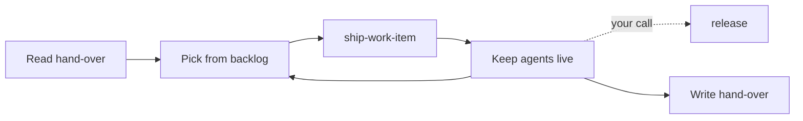

# Fluyt

**For agents who think "merged" means "done".**

Your agents write the code. Fluyt makes them finish the job.
Fluyt is a plugin marketplace that holds one plugin, `fluyt`, for Claude Code and Codex.
Install it in a repo and your agent sessions follow one tested ritual from issue to merge, instead of
improvising a new one every session.

> **Status:** MIT licensed. `CHANGELOG.md` holds the current version and every change.

## Why

Coding agents write code well. The work around the code is where they slip:

- the CHANGELOG entry is skipped, or the version bump is wrong;
- the release branch gets squashed and its per-item history is gone;
- the PR merges, but its issue stays open;
- a context reset wipes the session's state, and the next session starts by guessing;
- a background sub-agent goes quiet, and nobody can tell whether it is working or dead;
- ten repos with ten sessions, and no one place that knows what is running, what is blocked and
  what needs you.

Fluyt turns each of these into a written ritual, a specialist role or a guard hook. The process
lives in the plugin. Your repo keeps only its own facts.

## What you get

- **One work item, shipped end to end:** branch, implement, test, CHANGELOG and version, `Closes #N`,
  PR, auto-merge, then a check that the issue really closed.
- **A backlog and releases that stay honest:** tiered issues, a fixed selection order, and a release
  that is always a merge commit, never a squash.
- **Orchestration:** one main session that delegates to six specialist roles, runs parallel lanes in
  worktrees, and checks reports before trusting them.
- **Hand-overs that survive a context reset:** written from the tree, not from memory, so a successor
  can act without the transcript.
- **A cross-project hub:** one session that coordinates many project sessions, relays your decisions
  verbatim, and never runs a project's work itself.
- **Onboarding and re-sync:** start a new repo from scratch, adopt an existing one, or check a repo
  for drift after a plugin update.
- **GitHub or Azure DevOps**, and **Claude Code or Codex**, from one payload.

Fluyt ships itself with its own process.

## Quick start

**Requires** a GitHub repo with Issues and an authenticated `gh` CLI (or Azure DevOps with an
authenticated `az`, via `forge-azure-devops`), and a plugin-capable Claude Code or Codex client.
On Claude Code, the five hooks also need **Node.js 18 or later** on `PATH`: each is a `node -e`
one-liner, so without it their Node logic is inert, and each says so whenever it is skipped.
The full guide is [`docs/consumer-integration.md`](docs/consumer-integration.md).

### 1. Install the plugin

**Claude Code.** Merge this into your repo's committed `.claude/settings.json`, so anyone who opens
the repo is prompted to install it:

```json
{
  "extraKnownMarketplaces": {
    "fluyt": {
      "source": { "source": "github", "repo": "ArjenVanSilfhout/fluyt", "ref": "main" },
      "autoUpdate": true
    }
  },
  "enabledPlugins": { "fluyt@fluyt": true }
}
```

Keep `"ref": "main"`. The repo's default branch is `dev` (integration); `main` is the release branch.

Or install by hand (this tracks the default branch, `dev`; the JSON above is the way to pin `main`):

```text
/plugin marketplace add ArjenVanSilfhout/fluyt
/plugin install fluyt@fluyt
```

**Codex.**

```powershell
codex plugin marketplace add ArjenVanSilfhout/fluyt --ref main
codex plugin add fluyt@fluyt
codex plugin list
```

Then start a new session or task, so the client loads the new skills.

### 2. Adopt the conventions

Run `fluyt:adopt-conventions` in your repo (`/fluyt:adopt-conventions` on Claude Code,
`$fluyt:adopt-conventions` on Codex). It writes your **Project Facts** block, merges the
settings, `.gitignore`, `.gitattributes`, CHANGELOG and DECISIONS skeletons without overwriting your
own, interviews you for your repo's invariants, and proposes retiring local process files the plugin
now covers.

### 3. Ship something

```text
/fluyt:ship-work-item
```

On Codex: `$fluyt:ship-work-item`.

### Staying current

**Claude Code**, three steps, each needed: `claude plugin marketplace update fluyt` refreshes the
marketplace clone; `claude plugin update fluyt@fluyt` re-points the install record at the new
payload (for a repo with a project-scoped record, run it from that folder with `--scope project`);
then restart Claude Code, because a running session can keep the payload it loaded. **Codex:**
`codex plugin marketplace upgrade fluyt`, then `codex plugin add fluyt@fluyt`, then start a new
task. On either client, then run `adopt-conventions` in re-sync mode ("re-sync the conventions").
It proposes what changed and applies nothing without your yes.

## What's inside

Sixteen skills, six specialist roles, five Claude Code hooks and ten templates, grouped here by what
they get done.

### Ship one work item

| Skill | What it does |
| --- | --- |
| [`ship-work-item`](plugins/fluyt/skills/ship-work-item/SKILL.md) | The delivery ritual: issue, branch, implement, test, CHANGELOG and version, `Closes #N`, PR, auto-merge, close check. |
| [`versioning-and-changelog`](plugins/fluyt/skills/versioning-and-changelog/SKILL.md) | The CHANGELOG as the single source of truth, and the MINOR-versus-PATCH rule. |

### Backlog and releases

| Skill | What it does |
| --- | --- |
| [`backlog`](plugins/fluyt/skills/backlog/SKILL.md) | Pick the next item, file and re-tier issues, run a hygiene scan. Reads your label scheme from Project Facts. |
| [`release`](plugins/fluyt/skills/release/SKILL.md) | Promote the integration branch to the release branch with a merge commit, never a squash, and tag it if you use tags. |
| [`branch-protection`](plugins/fluyt/skills/branch-protection/SKILL.md) | Offer or audit rulesets, merge methods and required checks, plus a CI-trigger audit. |

### Orchestration and parallel lanes

| Skill | What it does |
| --- | --- |
| [`orchestrator`](plugins/fluyt/skills/orchestrator/SKILL.md) | The main session's posture: delegate, verify, loop. Routes to the skill that owns each step. |
| [`agent-liveness`](plugins/fluyt/skills/agent-liveness/SKILL.md) | Tell a working sub-agent from a dead one without reading its transcript; resume rather than re-dispatch. |
| [`scrum`](plugins/fluyt/skills/scrum/SKILL.md) | A retrospective on the agent team and the workflow. It proposes; you decide. |

### Hand-overs across context resets

| Skill | What it does |
| --- | --- |
| [`handover`](plugins/fluyt/skills/handover/SKILL.md) | A hand-over a successor can act on without the transcript, written from the tree and stored where Project Facts says. |

### A hub for many repos

| Skill | What it does |
| --- | --- |
| [`hub`](plugins/fluyt/skills/hub/SKILL.md) | One hub session coordinating many project sessions: a message protocol, verbatim decision relay, roster hygiene, a context watch and away mode. A relayed answer counts as approval only where you gave it. |

### Onboarding and upkeep

| Skill | What it does |
| --- | --- |
| [`adopt-conventions`](plugins/fluyt/skills/adopt-conventions/SKILL.md) | From scratch, first-time adopt, or re-sync after an update. Non-destructive. |
| [`install-refresh-plugin`](plugins/fluyt/skills/install-refresh-plugin/SKILL.md) | Install, refresh and diagnose the plugin on either client. |
| [`hook-authoring`](plugins/fluyt/skills/hook-authoring/SKILL.md) | Read before you write a Claude Code hook: output files, timezones, repo-root paths, silent failures. |
| [`report-upstream`](plugins/fluyt/skills/report-upstream/SKILL.md) | File a bug or feature request about the plugin itself. Strips provenance by default, runs from the main session only (sub-agents and worker lanes hand their draft up), and refuses when Project Facts `report-upstream` is `off`. |

### Other forges and clients

| Skill | What it does |
| --- | --- |
| [`forge-azure-devops`](plugins/fluyt/skills/forge-azure-devops/SKILL.md) | Translates the GitHub steps to `az`: Boards work items, PR auto-complete, work-item linking, branch policies. Its recipes are still pending verification by a consumer. |
| [`dispatch-role`](plugins/fluyt/skills/dispatch-role/SKILL.md) | The Codex adapter that dispatches the six specialist roles. |

### Specialist roles

| Role | What it does |
| --- | --- |
| [`developer`](plugins/fluyt/agents/developer.md) | Implements a well-specified task and builds to confirm it compiles. |
| [`test-writer`](plugins/fluyt/agents/test-writer.md) | Writes tests only under your test directory; never "fixes" product code to make a test pass. |
| [`preflight-reviewer`](plugins/fluyt/agents/preflight-reviewer.md) | Read-only pre-PR gate: build, tests, diff scope, CHANGELOG, version class, closing keyword. |
| [`product-owner`](plugins/fluyt/agents/product-owner.md) | Turns a rough idea into a decision-ready spec with acceptance criteria. |
| [`tech-debt-reviewer`](plugins/fluyt/agents/tech-debt-reviewer.md) | Read-only code-health and doc-drift review. |
| [`scrum-master`](plugins/fluyt/agents/scrum-master.md) | Read-only analyst behind `scrum`. |

### Hooks and templates

Five Claude Code hooks, in [`hooks/hooks.json`](plugins/fluyt/hooks/hooks.json):

- **blocks** deleting a branch that heads an open PR;
- **blocks** a `Co-Authored-By` trailer, only when your Project Facts forbid it;
- **echoes** the PR body's closing keywords before a merge is armed;
- **echoes** the staged CHANGELOG entry's date against today's UTC date;
- **logs** each finished sub-agent to a local feed that `scrum` reads.

Every hook fails open: if it can't decide, it lets the command through, and it says so when Node
is missing (see *Trust and data*).

Ten templates ship with [`adopt-conventions`](plugins/fluyt/skills/adopt-conventions/SKILL.md)
and [`branch-protection`](plugins/fluyt/skills/branch-protection/SKILL.md): a Project Facts
block, CLAUDE.md and AGENTS.md skeletons, a settings fragment, `.gitattributes` and `.gitignore`
fragments, CHANGELOG and DECISIONS skeletons, a GitHub-labels bootstrap script and a branch ruleset.

## How it works

- **Project Facts.** Your repo's `CLAUDE.md` carries a Project Facts block: build and test commands,
  paths, labels, branch names, forge. Skills and roles read those keys by name ("run the `test-cmd`")
  and never hard-code a command. If a key they need is missing, they stop and ask. The plugin itself
  holds no project facts, and validation enforces that.
- **Skills own steps; the orchestrator routes.** Each step of the work has one skill that owns it.
  The `orchestrator` skill names the chain (below) and restates none of it.
- **Hooks in front, prose behind.** A hook is prevention placed in front of a rule. The written
  skill stays the authority on both clients.
- **Releases track a branch.** Consumers pin `main`; there is no build artifact. The Claude manifest
  carries no version and follows the branch tip. The Codex manifest carries a strict SemVer version
  that mirrors `CHANGELOG.md`, and validation rejects drift between them.
- **Validated on every change.** `scripts/validate-local.ps1` is the local gate: manifests, skill
  frontmatter, role reachability, skill registration in the docs, the zero-project-facts check and a
  Markdown pre-flight. CI ([`.github/workflows/validate.yml`](.github/workflows/validate.yml)) adds
  `claude plugin validate`, markdownlint, PSScriptAnalyzer and the same invariant gate.

The session loop the `orchestrator` skill conducts:



Run the local gate:

```powershell
pwsh -NoProfile -File scripts/validate-local.ps1
```

## Claude Code and Codex

Both clients install the same payload from the same repo.

| | Claude Code | Codex |
| --- | --- | --- |
| Invoke a skill | `/fluyt:<skill>` | `$fluyt:<skill>` |
| Specialist roles | Native agents, `fluyt:<role>` | Through `dispatch-role`, which reads the same role files |
| Hooks | All five | None; Codex has no hook mechanism, so the skills' written rules apply |
| Manifest version | None; tracks `main` | Strict SemVer, mirrors `CHANGELOG.md` |

`adopt-conventions` records which clients a repo uses (`agent-clients: claude | codex | both`) and
adds an `AGENTS.md` pointer for Codex, so Project Facts stay in one place.

## Trust and data

What the plugin runs, sends and fetches. **No telemetry, no analytics, no phone-home, and no remote
instruction loading.**

- **Runs.** Skills and roles are prose instructions; your agent runs commands under your client's own
  permission prompts. The only code the plugin runs by itself is the five Claude Code hooks in
  [`hooks/hooks.json`](plugins/fluyt/hooks/hooks.json), each a local `node -e` one-liner:
  - Four `PreToolUse` hooks on `Bash` read the tool input, your repo's `CLAUDE.md` and, for the
    CHANGELOG echo, `git diff --cached` and `git show`. They write nothing.
  - `SubagentStop` appends one line (timestamp, sub-agent type) to `docs/process/dispatch.local.md`
    in your repo, creating `docs/process/` if needed. It is the only write any hook makes.
  - **Without Node.js** on `PATH`, no hook's Node logic runs and nothing is blocked: each
    `PreToolUse` hook prints a one-line skip message, and `SubagentStop` still writes its line,
    tagged `(fallback: node not on PATH)`.
  - **Network:** two hooks call `gh` (`gh pr list` before a branch delete, `gh pr view` before a
    merge). That is a call to GitHub using your own `gh` login, and nothing else.
  - **Codex runs no hooks.**
- **Sends.** Nothing of its own. The only outbound traffic is what your agent does on your
  instruction with your own credentials: `git`, and `gh` or `az` against your own forge.
  `report-upstream` files an issue to this plugin's home repo, but only when you run it, and it
  shows you the exact title, labels and body and **waits for your confirmation** before filing.
  It strips provenance from the draft by default, and Project Facts `report-upstream: off` stops it
  filing at all.
- **Fetches.** No instruction is loaded from a remote source: every skill, role and hook ships in
  the installed payload, and updates arrive only through your client's own marketplace update. One
  role, `product-owner`, is granted `WebSearch` and `WebFetch` to research external references for a
  spec; that reads web pages as evidence, not as instructions to follow.

## Status

The MIT license is in place. See [`CHANGELOG.md`](CHANGELOG.md) for the current version
and every change, and [`DECISIONS.md`](DECISIONS.md) for the founding decisions.

The plugin name `fluyt` is permanent: it is the plugin ID your clients record, so it will not be
renamed. If a rename were ever forced, a renames map would be published alongside it.

Bugs and feature requests: open an issue, or run `report-upstream` from a repo that uses the plugin.

## Compatibility

- **Tested clients.** Claude Code 2.1.296 (2026-10-11; CI
  installs the latest `@anthropic-ai/claude-code` on each run). **Codex support is written but
  untested**: no Codex version is claimed.
- **MINOR** (`X.Y.0`) means a skill, agent, hook, or template changed an instruction or output you
  follow, so read the CHANGELOG entry. **PATCH** (`X.Y.Z`) is wording, clarification, scripts, CI,
  or docs: nothing you follow changes. From 1.0, **MAJOR** marks a breaking change that needs
  changes to your own setup, such as a removed or renamed Project Facts key.
- **Support.** Only the latest minor release is supported. Fixes land on the newest version and
  are not backported. You track the release branch, so updating the plugin is the fix.

## License

MIT. See [`LICENSE`](LICENSE). The licence covers everything in this repository, including the prose
assets (skills, agent definitions, hooks, templates and docs), not just the scripts. The one
exception is [`CODE_OF_CONDUCT.md`](CODE_OF_CONDUCT.md), adapted from the Contributor Covenant under
CC BY 4.0; see [`THIRD_PARTY_NOTICES.md`](THIRD_PARTY_NOTICES.md).
